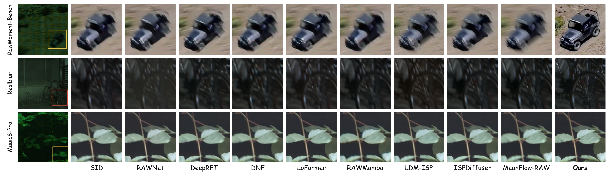
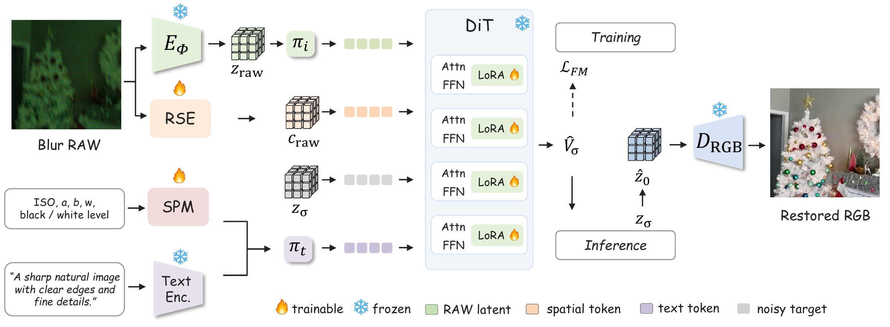

# RawMoment: Recovering the Sharp Moment via Generative RAW-to-RGB Deblurring

Training and inference code accompanying the paper.

## Contact

For questions about RawMoment, [open an issue](https://github.com/script-Yang/rawmoment/issues/new) or contact Sicheng Yang at [syang671@connect.hkust-gz.edu.cn](mailto:syang671@connect.hkust-gz.edu.cn).

## Qualitative comparison

[](assets/visuals/rawmoment_qualitative_comparison.pdf)

Qualitative comparisons on RawMoment-Bench, RealBlur, and Magic8-Pro.

## Method overview



RawMoment adapts a RAW encoder to the pretrained RGB latent space, then restores sharp RGB images with spatial and sensor-physics conditioning.

## Resources

### Datasets

[](https://huggingface.co/datasets/yscript/RawMoment)

| Dataset | Contents | Download |
| --- | --- | --- |
| RawMoment | 29,634 training samples and 366 validation samples for Stage 1 / Stage 2 | [Train](https://huggingface.co/datasets/yscript/RawMoment/tree/main/rawmoment_data/train) · [Validation](https://huggingface.co/datasets/yscript/RawMoment/tree/main/rawmoment_data/val) |
| RawMoment-Bench | 200 test samples; 512 × 512 and native 1024 × 1024 inference | [Test](https://huggingface.co/datasets/yscript/RawMoment/tree/main/rawmoment_data/test) |
| RealBlur, processed for RawMoment | 3,758 training pairs and 980 test pairs; 512 × 512 evaluation | [Train](https://huggingface.co/datasets/yscript/RawMoment/tree/main/realblur_processed_data/train) · [Test](https://huggingface.co/datasets/yscript/RawMoment/tree/main/realblur_processed_data/test) |
| GoPro, processed for RawMoment | 6,309 training samples (2,103 source pairs × 3 variants) and 1,111 test samples; 512 × 512 | [Train](https://huggingface.co/datasets/yscript/RawMoment/tree/main/gopro_processed_data/train) · [Test](https://huggingface.co/datasets/yscript/RawMoment/tree/main/gopro_processed_data/test) |

Dataset downloads require manual access approval.

### Model checkpoints

[](https://huggingface.co/yscript/RawMoment)

| Training resolution | Stage 1 VAE | Stage 2 DiT |
| --- | --- | --- |
| 512 × 512 | [stage1-vae](https://huggingface.co/yscript/RawMoment/blob/main/512/stage1-vae.safetensors) | [stage2-dit](https://huggingface.co/yscript/RawMoment/blob/main/512/stage2-dit.safetensors) |
| 1024 × 1024 | [stage1-vae](https://huggingface.co/yscript/RawMoment/blob/main/1024/stage1-vae.safetensors) | [stage2-dit](https://huggingface.co/yscript/RawMoment/blob/main/1024/stage2-dit.safetensors) |

Stage 2 checkpoints contain DiT adapters and conditioners. The checkpoint repository is currently private.

## Installation

Python 3.10+ and a CUDA GPU are required. Install PyTorch for your CUDA version, then install Diffusers with Qwen-Image-2.1 support and this package:

```bash
pip install git+https://github.com/huggingface/diffusers.git
pip install -e '.[train]'
```

Run the following commands from the repository root. Download the base model components:

```bash
hf download Qwen/Qwen-Image-2.1 --local-dir pretrained_models/Qwen-Image-2.1 \
  --include 'vae/*' 'transformer/*' 'scheduler/*'
```

The fixed prompt embeddings are included in [`assets/`](assets/).

## Data

The [Hugging Face dataset](https://huggingface.co/datasets/yscript/RawMoment) contains RawMoment training and validation data, RawMoment-Bench, and processed RealBlur and GoPro training and test data. Downloads require manual access approval.

RawMoment training pairs are synthesized from [OpenVid-1M](https://github.com/NJU-PCALab/OpenVid-1M).

RawMoment training, validation and RawMoment-Bench test data follow the same
data-construction protocol described in the paper.

Processed RealBlur is derived from [RealBlur](https://github.com/rimchang/RealBlur).

Processed GoPro follows the same data preparation protocol as the RawMoment training and test data in the paper. It retains the official GOPRO_Large train/test split. See the [data notes](https://huggingface.co/datasets/yscript/RawMoment/blob/main/gopro_processed_data/README.md).

After your request is approved, download and extract the data:

```bash
hf auth login
hf download yscript/RawMoment --repo-type dataset --local-dir data
(cd data && find rawmoment_data realblur_processed_data gopro_processed_data -name '*.tar' -exec tar -xf {} \;)
```

```text
data/
├── rawmoment_data/
│   ├── train/
│   ├── val/
│   └── test/       # RawMoment-Bench
├── realblur_processed_data/
│   ├── train/
│   └── test/
└── gopro_processed_data/
    ├── train/
    └── test/
```

See [DATA.md](DATA.md) for manifest fields, image formats and normalization.

## Weights

With access to the checkpoint repository, download a matching `stage1-vae` and `stage2-dit` pair from the [model checkpoints table](#model-checkpoints) into `weights/`:

```bash
hf download yscript/RawMoment --repo-type model --local-dir weights \
  --include '512/*' '1024/*'
```

Use a Stage 1/Stage 2 pair trained at the same resolution. Stage 2 checkpoints contain adapters and conditioners; the Qwen backbone is loaded from `model.base`.

## Inference

RawMoment-Bench, 512 × 512 center crop:

```bash
rawmoment-infer --config configs/stage2_512.yaml \
  --dataset rawmoment_bench --manifest data/rawmoment_data/test/manifest.jsonl \
  --size 512 --output outputs/rawmoment_bench_512
```

RawMoment-Bench, native 1024 × 1024:

```bash
rawmoment-infer --config configs/stage2_1024.yaml \
  --dataset rawmoment_bench --manifest data/rawmoment_data/test/manifest.jsonl \
  --size 1024 --output outputs/rawmoment_bench_1024
```

Processed RealBlur, 512 × 512 valid crop:

```bash
rawmoment-infer --config configs/stage2_512.yaml \
  --dataset realblur --manifest data/realblur_processed_data/test/manifest.jsonl \
  --size 512 --output outputs/realblur_512
```

Processed GoPro, native 512 × 512, using the released RawMoment 512 weights:

```bash
rawmoment-infer --config configs/stage2_512.yaml \
  --dataset gopro --manifest data/gopro_processed_data/test/manifest.jsonl \
  --size 512 --output outputs/gopro_512
```

GoPro uses native predictions without RealBlur's brightness alignment. To evaluate a model trained on GoPro, use `configs/stage2_gopro_512.yaml` after training.

Inference uses 40 Euler steps. Predictions are saved as PNG16 under `predictions/`, with sample records in `predictions.jsonl` and settings in `run.json`. Add `--limit 1` for a single image or `--save-gt` to export matching targets. Use a separate output directory for each run.

For **RealBlur only**, apply the paper's GT-assisted brightness alignment after inference:

Data preparation and evaluation follow the protocols described in the paper.

```bash
rawmoment-align-realblur --run outputs/realblur_512 \
  --manifest data/realblur_processed_data/test/manifest.jsonl
```

This fits one scalar per image over all RGB channels, `gain = sum(pred * GT) / sum(pred²)`,
using the fixed fully valid 512 crop. It clips the scaled prediction to `[0,1]` and saves
PNG16 images under `outputs/realblur_512/brightness_rgb_gt/predictions/`. Use these saved
images for RealBlur metrics. Native predictions are preserved; fitted gains and the protocol
are recorded in the new directory. This command rejects RawMoment-Bench runs and already
aligned runs. **RawMoment-Bench uses native predictions without brightness alignment.**

## Training

Stage 1 aligns the RAW encoder with the RGB VAE. Stage 2 trains the RAW conditioning modules and attention LoRA with flow matching.

The training configs use these manifests by default:

| Stage | Manifest |
| --- | --- |
| Stage 1 | `data/rawmoment_data/train/stage1.jsonl` |
| Stage 2 | `data/rawmoment_data/train/stage2.jsonl` |

```bash
rawmoment-train --stage stage1 --config configs/stage1_512.yaml --output outputs/stage1_512
rawmoment-train --stage stage2 --config configs/stage2_512.yaml --output outputs/stage2_512
```

Before training Stage 2, set `model.stage1_weights` to the trained Stage 1 checkpoint. Use the `_1024.yaml` configs for 1024 × 1024 training. LPIPS downloads VGG16 weights on first use; for offline training, set `perceptual.vgg_weights` in the Stage 1 config.

For GoPro Stage 2 training with the released 512 Stage 1 weights:

```bash
rawmoment-train --stage stage2 --config configs/stage2_gopro_512.yaml \
  --output outputs/stage2_gopro
```

This config trains Stage 2 from initialization with the Stage 1 model frozen. It uses only the 6,309 training samples; the 1,111 test samples are held out. GoPro provides no clean RAW images for Stage 1 training. Data preparation follows the paper's RawMoment training/test protocol.

For distributed training:

```bash
torchrun --standalone --nproc_per_node=4 -m rawmoment.train \
  --stage stage2 --config configs/stage2_1024.yaml --output outputs/stage2_1024
```

`batch_size` is the global effective batch; `micro_batch_size` is per GPU. Resume a run with `--resume <output>/last.pt`, using the same config, data and GPU count.

## License

Code: [Apache-2.0](LICENSE). Qwen-Image-2.1 and the datasets retain their respective licenses. Dataset terms are listed on [Hugging Face](https://huggingface.co/datasets/yscript/RawMoment/blob/main/DATA_TERMS.md).

## Acknowledgments

We thank the [Qwen-Image team](https://huggingface.co/Qwen/Qwen-Image-2.1) for the pretrained backbone and the teams behind [OpenVid-1M](https://github.com/NJU-PCALab/OpenVid-1M), [RealBlur](https://github.com/rimchang/RealBlur), and [GoPro](https://github.com/SeungjunNah/DeepDeblur_release) for their datasets.

## Citation

If you use RawMoment in your research, please cite:

```bibtex
@misc{yang2026rawmoment,
  title={{RawMoment}: Recovering the Sharp Moment via Generative {RAW}-to-{RGB} Deblurring},
  author={Sicheng Yang and Song Fei and Tian Ye and Jianan Sun and Bin Chen and Yu Wang and Lei Zhu},
  year={2026},
  note={Preprint}
}
```
